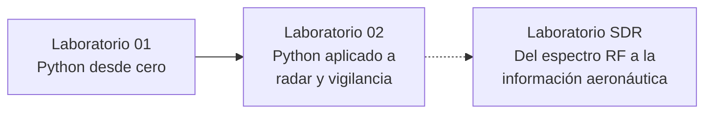

<p align="center"></p>

<h1 align="center">Del primer <code>print</code> al eco radar</h1>

<p align="center">
  <b>Python, radar y vigilancia aeronáutica, aprendidos calculando.</b><br>
  Dos notebooks en español que llevan desde cero en programación hasta la ecuación radar,<br>
  y un manual SDR que conecta esos modelos con señales RF reales.
</p>

<p align="center">
  <a href="https://colab.research.google.com/github/marcoteran/python-vigilancia-labs/blob/main/notebooks/01_python_desde_cero.ipynb"><b>Abrir Laboratorio 01 en Colab</b></a> ·
  <a href="https://colab.research.google.com/github/marcoteran/python-vigilancia-labs/blob/main/notebooks/02_calculos_vigilancia.ipynb"><b>Abrir Laboratorio 02 en Colab</b></a> ·
  <a href="lab_SDR_surveillance_LaTeX/laboratorio_sdr_surveillance.pdf"><b>Manual SDR (PDF)</b></a>
</p>

---

**Para quién es.** Para estudiantes que nunca han programado y quieren entender, con números y gráficos, cómo un radar mide la distancia, por qué un eco es tan débil, cómo una antena forma un haz y qué diferencia hay entre PSR, SSR, Mode S y ADS-B. También para instructores que necesitan material reproducible, con soluciones separadas y validación automática.

**Qué lo distingue.** Cada fórmula declara sus variables, unidades y supuestos; cada gráfico se interpreta físicamente; cada ejercicio muestra la salida esperada. Los modelos son didácticos y los datos, sintéticos: el repositorio nunca presenta una simulación como si fuera una medición.

## Contenido

- [La ruta de aprendizaje](#la-ruta-de-aprendizaje)
- [Empieza ahora](#empieza-ahora)
- [Los tres laboratorios](#los-tres-laboratorios)
- [Qué verás en los notebooks](#qué-verás-en-los-notebooks)
- [Laboratorio SDR](#laboratorio-sdr)
- [Instalación local](#instalación-local)
- [Cómo está diseñado el aprendizaje](#cómo-está-diseñado-el-aprendizaje)
- [Validación y reproducibilidad](#validación-y-reproducibilidad)
- [Estructura del repositorio](#estructura-del-repositorio)
- [Para instructores](#para-instructores)
- [Referencias, autoría y contribución](#referencias-autoría-y-contribución)

## La ruta de aprendizaje



Es una progresión recomendada, no una cadena obligatoria. Los notebooks funcionan sin hardware y sin el manual SDR. El manual SDR es útil por sí solo, pero exige más que los notebooks: hardware RF, instalación de software en Windows y Ubuntu, y supervisión durante las prácticas de transmisión. Cada instructor puede elegir qué actividades asignar.

## Empieza ahora

No necesitas instalar nada: los notebooks se abren en Google Colab, que puede requerir una cuenta de Google para ejecutar y guardar.

| | Laboratorio | Abrir | Descargar |
|---|---|---|---|
| **01** | Python desde cero | [](https://colab.research.google.com/github/marcoteran/python-vigilancia-labs/blob/main/notebooks/01_python_desde_cero.ipynb) | [`.ipynb`](https://raw.githubusercontent.com/marcoteran/python-vigilancia-labs/main/notebooks/01_python_desde_cero.ipynb) |
| **02** | Python aplicado a radar y vigilancia | [](https://colab.research.google.com/github/marcoteran/python-vigilancia-labs/blob/main/notebooks/02_calculos_vigilancia.ipynb) | [`.ipynb`](https://raw.githubusercontent.com/marcoteran/python-vigilancia-labs/main/notebooks/02_calculos_vigilancia.ipynb) |
| **SDR** | Del espectro RF a la información aeronáutica | [Manual PDF](lab_SDR_surveillance_LaTeX/laboratorio_sdr_surveillance.pdf) | [Fuentes LaTeX](lab_SDR_surveillance_LaTeX/) |

En Colab:

1. **Archivo → Guardar una copia en Drive**, para trabajar sobre tu propia copia.
2. Ejecuta las celdas de arriba hacia abajo con ▶ o `Shift + Enter`.
3. En los ejercicios, cambia `None` por tu expresión y compara con la **salida esperada**.
4. Antes de entregar, reinicia la sesión y ejecuta todo: así compruebas que tu resultado se puede repetir.

No necesitas sensores, archivos de datos, claves ni montar Drive.

## Los tres laboratorios

### Laboratorio 01: Python desde cero

**Requisitos:** ninguno. Pensado para quien nunca ha escrito código.

Aprenderás a escribir y ejecutar instrucciones, guardar valores en variables, distinguir tipos, usar listas, decidir con `if`, repetir con `for`, crear funciones con valores por defecto, calcular con NumPy y dibujar gráficos con Matplotlib. Cada concepto sigue el mismo ciclo: qué es, para qué sirve, cómo se escribe, qué resultado esperar y cómo modificarlo.

Termina con **«Lo que ya sabes y cómo lo usarás en el Laboratorio 02»**: una tabla que conecta cada habilidad con un cálculo de radar, una lista de comprobación y un primer ejercicio de ida y vuelta de un pulso.

*9 ejercicios con salida esperada · 2 gráficos · 1 ilustración conceptual*

### Laboratorio 02: Python aplicado a radar y vigilancia

**Requisitos:** el Laboratorio 01. Toda sintaxis nueva se explica justo antes de usarla, en recuadros **«Python nuevo»**.

| § | Tema | Pregunta que responde |
|---|---|---|
| 1 | Unidades y decibelios | ¿Por qué la ingeniería RF suma dB en lugar de multiplicar potencias? |
| 2 | Alimentación | ¿Cuánto se pierde en un cable y cuánto dura una batería? |
| 3 | Señales, pulsos y ruido | ¿Qué revela la FFT y por qué un pulso corto deja entrar más ruido? |
| 4 | Propagación | ¿Llega suficiente potencia por un enlace de 200 km? |
| 5 | Antenas | ¿Cómo forma y orienta un haz un arreglo de elementos? |
| 6 | Ecuación radar | ¿Por qué el eco cae con R⁴ y el enlace con R²? |
| 7 | Del tiempo a la observación | ¿Qué miden PSR, SSR, Mode S, ADS-B y MLAT? |
| 8 | Información digital | ¿Cómo se convierte una señal en bits y los bits en mensajes? |
| 9 | Red | ¿Qué añade la red a la edad de un dato de vigilancia? |

Cierra con una misión de **doce cálculos de diagnóstico** sobre un mismo puesto de vigilancia y una reflexión sobre qué demuestra, y qué no, cada resultado.

*12 ejercicios con salida esperada · 8 gráficos calculados · 2 controles interactivos con alternativa sin widgets · 1 ilustración conceptual*

### Laboratorio SDR: del espectro RF a la información aeronáutica

**Requisitos:** los conceptos del Laboratorio 02 (dB, ancho de banda, muestreo, modulación, PSR/SSR/ADS-B), además de un banco con HackRF One, analizador SIGLENT SSA3032X Plus, atenuadores y antenas, y computadores con Windows 10/11 y Ubuntu 24.04. Ver [Laboratorio SDR](#laboratorio-sdr).

Duraciones: la [guía del instructor](instructor/guia_instructor.md) propone una sesión de una hora para el núcleo del Laboratorio 01 (la versión actual añade material para preparación previa) y una ruta guiada de tres horas para el Laboratorio 02. El manual SDR no fija una duración.

## Qué verás en los notebooks

Todos los gráficos se calculan con las mismas fórmulas que se enseñan; ninguno es una medición de equipos reales.

<p align="center"></p>

**Un haz con significado.** Lóbulo principal, nulos y lóbulos laterales de un arreglo de 16 elementos. Los controles cambian el número de elementos y la dirección; el texto explica por qué el haz se estrecha y por qué orientar no crea energía. Es un factor de arreglo idealizado, no el patrón medido de una antena.

<p align="center"></p>

**Enlace frente a eco.** En escala logarítmica, la ley 1/R² de un enlace y la ley 1/R⁴ del eco radar se vuelven rectas: −20 dB y −40 dB por cada década de distancia. Esta diferencia explica por qué un radar primario necesita decenas de kW.

<p align="center"></p>

**El viaje de ida y vuelta.** La ecuación radar monostática frente a un umbral ilustrativo. El cruce marca el límite del modelo didáctico, no un alcance operacional: no incluye probabilidad de detección, clutter ni fluctuación de la sección radar.

<details>
<summary><b>Dos ilustraciones conceptuales</b> (generadas con IA, revisadas e incrustadas en los notebooks)</summary>
<br>
<p align="center"></p>

**Documento y memoria.** El notebook guarda lo que escribiste; el kernel guarda las variables mientras está activo. Reiniciar y ejecutar todo comprueba que el resultado se puede repetir.

<p align="center"></p>

**Un recorrido, o ida y vuelta.** Elegir el modelo correcto empieza por identificar cuántas veces recorre la energía el camino.

Prompts y estado de cada ilustración: [`prompts/ilustraciones.md`](prompts/ilustraciones.md).
</details>

## Laboratorio SDR

<p>
  <a href="lab_SDR_surveillance_LaTeX/laboratorio_sdr_surveillance.pdf"><b>Abrir el manual (PDF, 41 páginas)</b></a> ·
  <a href="lab_SDR_surveillance_LaTeX/">Fuentes LaTeX y flowgraphs</a> ·
  <a href="lab_SDR_surveillance_LaTeX/README.md">Cómo compilarlo</a>
</p>

Un manual universitario de cinco prácticas con **HackRF One**, **SDRangel**, **GNU Radio Companion** y un analizador **SIGLENT SSA3032X Plus**. Su eje es distinguir niveles de evidencia: ver energía en un waterfall no es lo mismo que demodular, sincronizar, validar una trama o decodificar información, y lo que muestra la pantalla puede venir de bases de datos externas y no de la aeronave.

| # | Sistema | Práctica |
|---|---|---|
| 1 | Windows | **SDRangel · recepción FM y AM:** dispositivo frente a canal, offset, ancho de banda, ganancia y audio |
| 2 | Windows | **SDRangel · transmisión FM conducida:** tono de 1 kHz y micrófono, verificados en el analizador |
| 3 | Windows | **GNU Radio · transmisor FM conducido:** flowgraph propio, tasas de muestreo y remuestreo 25/6 |
| 4 | Ubuntu | **Wi-Fi/OFDM y BLE:** inventario SSID/BSSID/canal, waterfall, `gr-ieee802-11`, constelaciones y Wireshark |
| 5 | Ubuntu | **ADS-B/Mode S con SDRangel:** tabla de aeronaves, mapa, estadísticas, cobertura y datos radiados frente a externos |

> [!WARNING]
> **Seguridad RF.** Las prácticas 2 y 3 transmiten **solo por conexión conducida**: HackRF → atenuador de 30–60 dB → analizador, con RF Amp apagado, ganancia baja y la transmisión detenida antes de cambiar cualquier conexión. Nunca se transmite por antena. La práctica 4 es solo de recepción, con límites explícitos de privacidad.

> [!NOTE]
> El PDF se compiló sin errores y el texto se revisó técnicamente, pero los procedimientos **no** se han ensayado con hardware en esta revisión. Ensaya cada práctica en tu banco antes de la sesión.

## Instalación local

Usa esta ruta si prefieres Jupyter en tu computador en lugar de Colab. Necesitas **Python 3.10 o superior**.

Un **entorno virtual** (`.venv`) es una carpeta con su propio Python y sus propias librerías: lo que instales para este curso no altera otros proyectos. `requirements.txt` lista las librerías que usan los notebooks (NumPy, Matplotlib, pandas, ipywidgets y JupyterLab).

**Windows (PowerShell)**, desde la carpeta del repositorio:

```powershell
py -m venv .venv
.\.venv\Scripts\python.exe -m pip install -r requirements.txt
.\.venv\Scripts\python.exe -m jupyterlab
```

Si el comando `py` no existe, usa `python -m venv .venv`. Llamar directamente a `.\.venv\Scripts\python.exe` evita activar el entorno, así que no hace falta cambiar la política de ejecución de scripts de PowerShell.

**macOS o Linux:**

```bash
python3 -m venv .venv
source .venv/bin/activate
python -m pip install -r requirements.txt
python -m jupyterlab
```

JupyterLab se abre en el navegador; entra en `notebooks/` y abre el laboratorio.

## Cómo está diseñado el aprendizaje

**Observa → predice → ejecuta → modifica → interpreta.** El ciclo se repite en cada sección:

| Paso | Cómo aparece en los notebooks |
|---|---|
| Observa | Un problema físico o un ejemplo resuelto, antes de pedir nada |
| Predice | «Predice…» antes de ejecutar: comprometerse con una respuesta hace visible lo que no se entendió |
| Ejecuta | Celdas cortas con una sola idea nueva y la salida esperada a la vista |
| Modifica | «Modifica…» o «Experimenta…»: cambiar un parámetro y comparar |
| Interpreta | «Interpreta…» después de cada gráfico: qué relación física muestra y cuál es el límite del modelo |

En el Laboratorio 02, cada tema añade **problema → intuición → modelo con variables y unidades → código → interpretación → conexión con sistemas reales**. Los ejercicios cambian `None` por una expresión; la función `mostrar()` compara con tolerancia y deja pendientes los que faltan, sin detener el notebook.

## Validación y reproducibilidad

Esta sección es para quien modifica el repositorio. Instala también las dependencias de desarrollo:

```powershell
.\.venv\Scripts\python.exe -m pip install -r requirements-dev.txt
.\.venv\Scripts\python.exe scripts\verificar.py --in-process
```

En macOS o Linux: `python scripts/verificar.py`.

**Qué comprueba `verificar.py`:**

- estructura válida de ambos notebooks y que las imágenes incrustadas coinciden byte a byte con los archivos de `assets/`;
- que las plantillas del alumno se ejecutan completas en un kernel limpio, con los `None` sin resolver;
- que, al insertar las soluciones de [`instructor/soluciones.json`](instructor/soluciones.json), **cada** ejercicio imprime exactamente la salida esperada que muestra el notebook;
- invariantes físicos: caída de 12.04 dB al duplicar la distancia del radar, escalado con potencia y ganancia, dirección y nulos del arreglo, aliasing y coherencia de distancias PSR/SSR/Mode S;
- los controles interactivos y sus alternativas por llamada de función.

Después guarda los notebooks del alumno con salidas estáticas, exporta los gráficos a `assets/` y escribe [`docs/verificacion.json`](docs/verificacion.json). Revisa `git status` antes de confirmar: el verificador reescribe archivos.

**Qué no comprueba:** la interacción con widgets en un navegador, la ejecución en el frontend de Colab, el aprendizaje real de estudiantes ni ningún procedimiento con hardware RF.

**Por qué `--in-process`.** Por defecto, el verificador lanza kernels de Jupyter en procesos separados que se comunican por sockets ZeroMQ. En algunos equipos Windows, o en entornos que bloquean sockets, esa comunicación falla aunque los notebooks estén bien. `--in-process` ejecuta un kernel IPython dentro del mismo proceso, sin sockets, y el informe registra qué modo se usó. El flujo de [GitHub Actions](.github/workflows/verificar.yml) usa el modo por defecto en Ubuntu.

## Estructura del repositorio

```text
python-vigilancia-labs/
├── notebooks/
│   ├── 01_python_desde_cero.ipynb       # Laboratorio 01 (alumno)
│   └── 02_calculos_vigilancia.ipynb     # Laboratorio 02 (alumno)
├── lab_SDR_surveillance_LaTeX/
│   ├── laboratorio_sdr_surveillance.pdf # manual SDR compilado
│   ├── main.tex, laboratorio_sdr_3.tex  # fuentes LaTeX
│   ├── marco-academic.sty               # estilo del manual
│   ├── grc/                             # flowgraphs de referencia de GNU Radio
│   └── README.md                        # compilación y estado
├── instructor/
│   ├── guia_instructor.md               # conducción de clase, tiempos y errores frecuentes
│   ├── soluciones_01.md, soluciones_02.md
│   └── soluciones.json                  # soluciones que usa el verificador
├── assets/                              # banner, encabezados, gráficos exportados e ilustraciones
├── docs/                                # cobertura, referencias, auditoría y evidencia de verificación
├── prompts/                             # prompts de las ilustraciones y de publicación
├── scripts/verificar.py                 # validación reproducible
├── requirements.txt                     # dependencias de los notebooks
└── requirements-dev.txt                 # dependencias de validación
```

## Para instructores

- **[Guía del instructor](instructor/guia_instructor.md):** tiempos propuestos, preguntas para clase, errores que conviene provocar, criterios de avance, respuestas de las cápsulas y notas para el laboratorio SDR.
- **Soluciones:** [Laboratorio 01](instructor/soluciones_01.md) · [Laboratorio 02](instructor/soluciones_02.md). Son públicas y están separadas de los notebooks del alumno, que conservan los `None`.
- **[Cobertura temática](docs/cobertura.md):** dónde se trata cada una de las 54 familias de contenidos del curso.
- **[Auditoría pedagógica](docs/pedagogical_audit.md):** problemas encontrados, correcciones y limitaciones de la revisión de octubre de 2026.
- **[Modelos y referencias](docs/referencias.md)** y **[entorno verificado](docs/entorno_verificado.md)**.

Antes de impartir, abre cada enlace de Colab y prueba los controles desde la cuenta que usarás en clase.

## Referencias, autoría y contribución

Diseñado para el curso **Introducción teórica de vigilancia · IQV01** por **Marco Terán**, a partir de los materiales de clase del instructor. Los cálculos son modelos didácticos con datos sintéticos; no constituyen especificaciones de equipos ni procedimientos operacionales. Las fuentes primarias están en [`docs/referencias.md`](docs/referencias.md) y las del manual SDR, en su sección final.

**Contribuir.** Abre un issue con la sección, la fórmula o el texto afectado, el comportamiento esperado y la evidencia. Las propuestas deben mantener unidades e hipótesis explícitas, la ejecución completa de los notebooks y la separación entre material del alumno y del instructor. Detalles en [`CONTRIBUTING.md`](CONTRIBUTING.md).

**Uso.** El repositorio es público para lectura y descarga. No incluye una licencia de reutilización: la visibilidad pública no sustituye esa autorización, que corresponde al autor.
