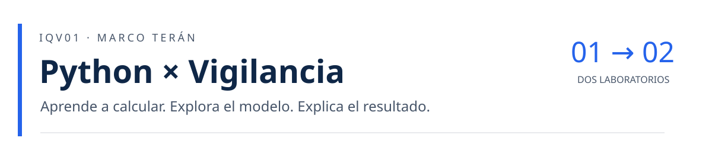
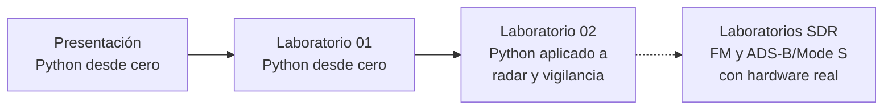
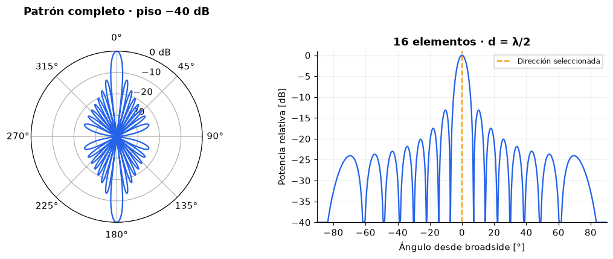
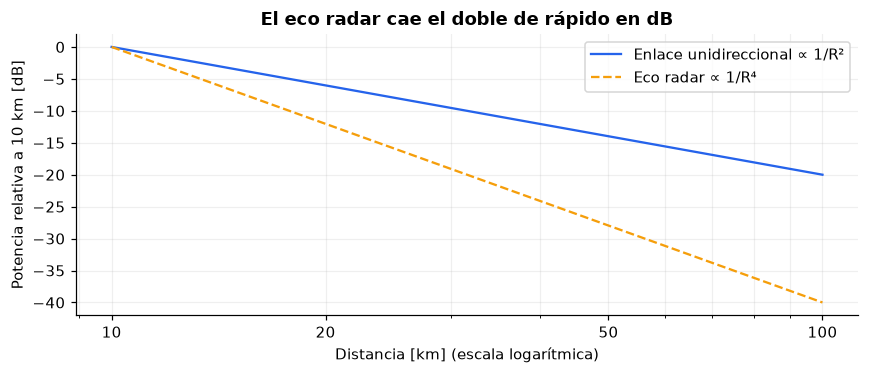
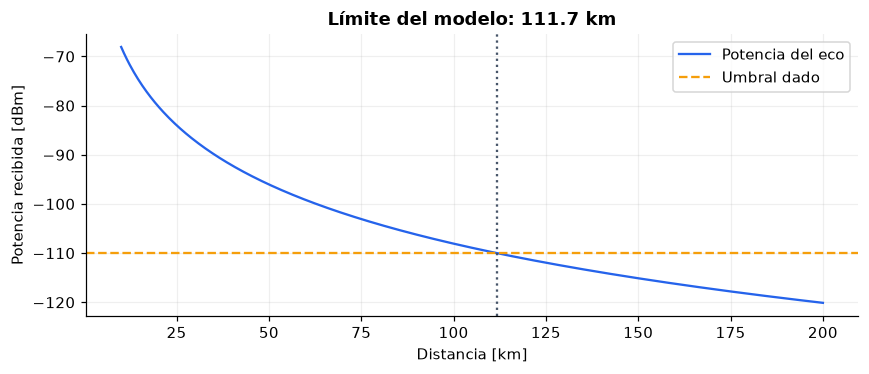
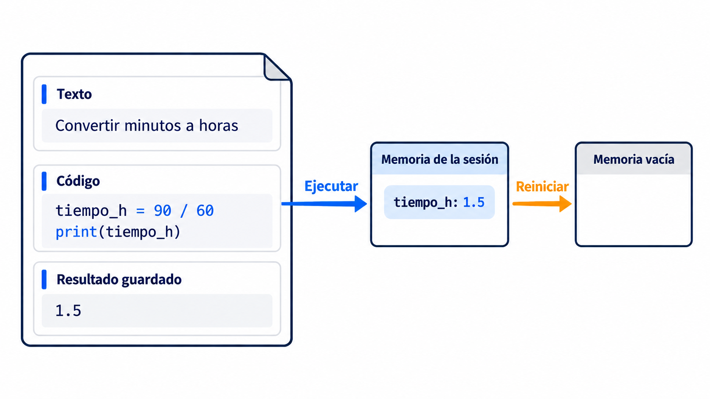
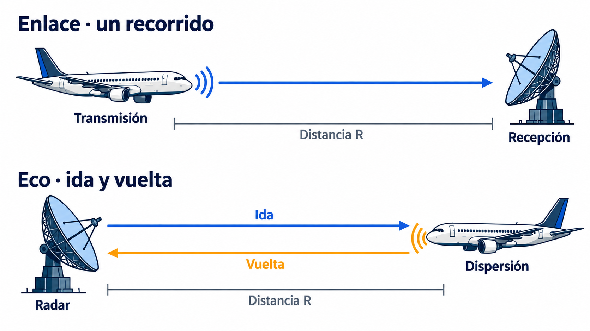
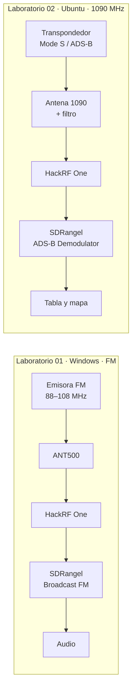

<p align="center"></p>

<h1 align="center">Del primer <code>print</code> al eco radar</h1>

<p align="center">
  <b>Python, radar y vigilancia aeronáutica, aprendidos calculando.</b><br>
  Una presentación y dos notebooks en español que llevan desde cero en programación hasta la ecuación radar,<br>
  y dos laboratorios SDR de solo recepción que conectan esos modelos con señales RF reales: FM y ADS-B/Mode S.
</p>

<p align="center">
  <a href="slides/python_lab_slides.pdf"><b>Presentación (PDF)</b></a> ·
  <a href="https://colab.research.google.com/github/marcoteran/python-vigilancia-labs/blob/main/notebooks/01_python_desde_cero.ipynb"><b>Laboratorio 01 en Colab</b></a> ·
  <a href="https://colab.research.google.com/github/marcoteran/python-vigilancia-labs/blob/main/notebooks/02_calculos_vigilancia.ipynb"><b>Laboratorio 02 en Colab</b></a> ·
  <a href="lab_SDR_surveillance_LaTeX/laboratorio_sdr_surveillance.pdf"><b>Manual SDR (PDF)</b></a> ·
  <a href="#implementos-y-dónde-comprarlos"><b>Implementos del laboratorio SDR</b></a>
</p>

---

**Para quién es.** Para estudiantes de vigilancia aeronáutica que nunca han programado y quieren entender, con números y gráficos, cómo un radar mide la distancia, por qué un eco es tan débil, cómo una antena forma un haz y qué diferencia hay entre PSR, SSR, Mode S y ADS-B. También para instructores que necesitan material reproducible, con soluciones separadas y validación automática.

**Qué lo distingue.** Cada fórmula declara sus variables, unidades y supuestos; cada gráfico se interpreta físicamente; cada ejercicio muestra la salida esperada. Los modelos son didácticos y los datos de los notebooks, sintéticos: el repositorio nunca presenta una simulación como si fuera una medición, ni una grabación como si fuera recepción en vivo.

## Novedades

- **Octubre de 2026 · Laboratorios SDR 3.0.** Edición aprobada para uso en clase, con el banco completo. Un **manual** corto organizado en etapas, un **Anexo A** con toda la teoría y el diagnóstico, y un **Anexo B** imprimible con cuestionarios y hojas de registro, más la guía del instructor. Incluye la [lista de implementos con enlaces de compra](#implementos-y-dónde-comprarlos) y una grabación real de 1090 MHz verificada.
- **Octubre de 2026 · Notebooks.** Revisión para principiantes absolutos, alineación con la presentación y verificador automático en GitHub Actions.

## Contenido

- [Novedades](#novedades)
- [Empieza aquí](#empieza-aquí)
- [La ruta de aprendizaje](#la-ruta-de-aprendizaje)
- [La presentación](#la-presentación)
- [Laboratorio 01: Python desde cero](#laboratorio-01-python-desde-cero)
- [Laboratorio 02: Python aplicado a radar y vigilancia](#laboratorio-02-python-aplicado-a-radar-y-vigilancia)
- [Qué verás en los notebooks](#qué-verás-en-los-notebooks)
- [Modelos, no mediciones](#modelos-no-mediciones)
- [Si algo falla](#si-algo-falla)
- [Laboratorios SDR con hardware](#laboratorios-sdr-con-hardware)
  - [Cuatro documentos](#cuatro-documentos)
  - [Implementos y dónde comprarlos](#implementos-y-dónde-comprarlos)
- [Instalación local (opcional)](#instalación-local-opcional)
- [Para instructores y mantenedores](#para-instructores-y-mantenedores)
- [Referencias, autoría y contribución](#referencias-autoría-y-contribución)

## Empieza aquí

No necesitas instalar nada. Los notebooks se abren en Google Colab, que puede pedirte una cuenta de Google para ejecutar y guardar.

| Paso | Material | Abrir | Descargar |
|---|---|---|---|
| **1** | Presentación: Python desde cero | [PDF, 28 páginas](slides/python_lab_slides.pdf) | — |
| **2** | Laboratorio 01 · Python desde cero | [](https://colab.research.google.com/github/marcoteran/python-vigilancia-labs/blob/main/notebooks/01_python_desde_cero.ipynb) | [`.ipynb`](https://raw.githubusercontent.com/marcoteran/python-vigilancia-labs/main/notebooks/01_python_desde_cero.ipynb) |
| **3** | Laboratorio 02 · Python aplicado a radar y vigilancia | [](https://colab.research.google.com/github/marcoteran/python-vigilancia-labs/blob/main/notebooks/02_calculos_vigilancia.ipynb) | [`.ipynb`](https://raw.githubusercontent.com/marcoteran/python-vigilancia-labs/main/notebooks/02_calculos_vigilancia.ipynb) |
| **4** | Laboratorios SDR · FM y ADS-B con hardware (opcional) | [Manual](lab_SDR_surveillance_LaTeX/laboratorio_sdr_surveillance.pdf) · [Anexo A](lab_SDR_surveillance_LaTeX/anexo_a_fundamentos_sdr.pdf) · [Anexo B](lab_SDR_surveillance_LaTeX/anexo_b_evaluacion_sdr.pdf) | [Grabación `.sdriq`](lab_SDR_surveillance_LaTeX/datos_adsb/modes1_dump1090_2MSps_1090MHz.sdriq) |

Para descargar un `.ipynb`, haz clic derecho en el enlace y elige **Guardar enlace como…**; solo lo necesitas para la [instalación local](#instalación-local-opcional).

### Tu primera sesión en Colab

1. **Archivo → Guardar una copia en Drive.** Trabaja siempre en tu copia: no modifica el original de GitHub y conserva tus respuestas.
2. **Conecta, si es necesario.** La primera celda puede tardar unos segundos mientras Colab prepara un entorno de ejecución.
3. **Ejecuta las celdas de arriba hacia abajo** con ▶ o `Shift + Enter`. Muchas usan datos creados en celdas anteriores.
4. **Predice antes de ejecutar** y compara con lo que aparece debajo de la celda.
5. **En los ejercicios**, cambia solo las líneas que contienen `None` por tus expresiones.

El archivo se guarda en Drive, pero las variables viven en la **sesión**: si Colab se desconecta o reinicias, se pierden aunque sigas viendo resultados antiguos. Vuelve a ejecutar desde el inicio (menú **Entorno de ejecución**, o `Ctrl + F9` para ejecutar todas).

No necesitas sensores, archivos de datos, claves ni montar Drive.

### Cómo saber que terminaste

| Laboratorio | Criterio |
|---|---|
| 01 | Los nueve ejercicios (E01–E04, M01–M04 y R01) imprimen **exactamente** la salida esperada, con su unidad. |
| 02 | Las doce hojas de la misión (Q01–Q12) muestran ✓ en cada línea y respondiste «Concluye con evidencia». |
| Ambos | Reiniciaste la sesión, ejecutaste todo de arriba abajo y los resultados se repitieron. |

El formato de entrega lo define tu instructor. Tu copia en Drive contiene tu trabajo; en Colab puedes descargarla con **Archivo → Descargar → Descargar .ipynb**.

## La ruta de aprendizaje



Primero se comprende la herramienta y después el fenómeno. La presentación explica cada idea con un diagrama; el Laboratorio 01 la convierte en código que ejecutas y modificas; el Laboratorio 02 la aplica a señales, propagación, antenas, radar y redes de vigilancia. Los dos laboratorios SDR son un complemento opcional con hardware, que lleva esos modelos a señales reales; los notebooks funcionan sin ellos.

## La presentación

[**`slides/python_lab_slides.pdf`**](slides/python_lab_slides.pdf) es la presentación de clase del Laboratorio 01 y un adelanto del 02. La presentación explica; el notebook te deja experimentar. No hay una correspondencia diapositiva por celda, pero cada idea tiene su lugar:

| Páginas del PDF | Idea | Dónde practicarla |
|---|---|---|
| 4, 7, 12 | Instrucciones y salida; qué es un notebook; el documento no es la memoria | Laboratorio 01 · §1 |
| 9, 10 | Entrar a Colab y tu primera sesión | [Empieza aquí](#empieza-aquí) |
| 8, 11 | Python, Jupyter, Colab y Anaconda; alternativa local | [Instalación local](#instalación-local-opcional) |
| 6, 13, 14 | Variables, operaciones, unidades y tipos | Laboratorio 01 · §2–§3 y E01 |
| 15, 16 | Listas e índices desde 0; condiciones con `if` | Laboratorio 01 · §4 y E02 |
| 17, 18 | Ciclos `for`; definir y llamar funciones | Laboratorio 01 · §5–§6 y E03 |
| 19–21 | Bibliotecas, NumPy y Matplotlib | Laboratorio 01 · §7–§8 y E04 |
| 22 | Leer un error y corregirlo | Laboratorio 01 · «Si algo falla» |
| 23 | Cómo trabajar el Laboratorio 01 | Ejercicios E01–E04, misión M01–M04 y puente R01 |
| 24, 25 | Alcance del Laboratorio 02; del pulso a la distancia, $R = c\,t/2$ | Laboratorio 01 · R01 y Laboratorio 02 · §7 |

## Laboratorio 01: Python desde cero

**Requisitos:** ninguno. Pensado para quien nunca ha escrito código.

**Al terminar podrás** ejecutar y modificar código en un notebook, guardar valores con nombre y unidad, distinguir tipos de datos, recorrer listas, decidir con `if`, repetir con `for`, crear funciones con valores por defecto, calcular con NumPy, dibujar gráficos con Matplotlib y explicar por qué un resultado antiguo en pantalla no prueba que tu código actual funcione.

| § | Tema | Practicas |
|---|---|---|
| 1 | Habla con el notebook | `print`, celdas, kernel y memoria |
| 2 | Una calculadora que recuerda | Variables, aritmética, f-strings, notación científica · **E01** |
| 3 | Valores de distintas clases | `int`, `float`, `str`, `bool` |
| 4 | Varios datos y una decisión | Listas, índices, porciones, comparaciones e `if` · **E02** |
| 5 | Una fórmula reutilizable | Funciones, `return`, valores por defecto, argumentos con nombre · **E03** |
| 6 | Repetir sin copiar | Ciclo `for` y barrido de parámetros |
| 7 | Una caja de herramientas | Bibliotecas, `import`, arrays de NumPy, umbrales |
| 8 | Ver los números | Gráficos de barras y curvas con Matplotlib · **E04** |
| 9 | Tu misión | Cuatro cálculos encadenados · **M01–M04** |
| — | Puente al Laboratorio 02 | Tabla de correspondencias, lista de comprobación y tiempo de ida y vuelta de un pulso · **R01** |

Cada concepto sigue el mismo ciclo: qué es, para qué sirve, cómo se escribe, qué resultado esperar y cómo modificarlo.

*9 ejercicios con salida esperada · 2 gráficos · 1 ilustración conceptual*

## Laboratorio 02: Python aplicado a radar y vigilancia

**Requisitos:** el Laboratorio 01. Toda sintaxis nueva se explica justo antes de usarla, en recuadros **«Python nuevo»**.

**Al terminar podrás** calcular e interpretar, con unidades explícitas, potencias en W, dBm y dB; señales en el tiempo y en la frecuencia; un enlace unidireccional (∝ 1/R²) frente a un eco radar (∝ 1/R⁴); el haz de un arreglo de antenas; qué mide cada sistema de vigilancia; y qué añaden la digitalización y la red.

| § | Tema | Pregunta que responde |
|---|---|---|
| 1 | Unidades y decibelios | ¿Por qué la ingeniería RF suma dB en lugar de multiplicar potencias? |
| 2 | Alimentación | ¿Cuánto se pierde en un cable y cuánto dura una batería? |
| 3 | Señales, pulsos y ruido | ¿Qué revela la FFT y por qué un pulso corto deja entrar más ruido? |
| 4 | Propagación | ¿Llega suficiente potencia por un enlace de 200 km? |
| 5 | Antenas | ¿Cómo forma y orienta un haz un arreglo de elementos? |
| 6 | Ecuación radar | ¿Por qué el eco cae con R⁴ y el enlace con R²? |
| 7 | Del tiempo a la observación | ¿Qué miden PSR, SSR, Mode S, ADS-B y MLAT? |
| 8 | Información digital | ¿Cómo se convierte una señal en bits y los bits en mensajes? |
| 9 | Red | ¿Qué añade la red a la edad de un dato de vigilancia? |

Cierra con una misión de **doce cálculos de diagnóstico** sobre un mismo puesto de vigilancia. La función `mostrar()` compara cada resultado con tolerancia y escribe ✓ o «revisa», sin detener el notebook. Las cápsulas «Explora más» amplían circuitos, ruido, propagación, aliasing y geometría TDoA.

*12 ejercicios con salida esperada · 8 gráficos calculados · 2 controles interactivos con alternativa sin widgets · 1 ilustración conceptual*

## Qué verás en los notebooks

Todos los gráficos se calculan con las mismas fórmulas que se enseñan; ninguno es una medición de equipos reales.

<p align="center"></p>

**Un haz con significado.** Lóbulo principal, nulos y lóbulos laterales de un arreglo de 16 elementos. Los controles cambian el número de elementos y la dirección; el texto explica por qué el haz se estrecha y por qué orientar no crea energía. Es un factor de arreglo idealizado, no el patrón medido de una antena.

<p align="center"></p>

**Enlace frente a eco.** En escala logarítmica, la ley 1/R² de un enlace y la ley 1/R⁴ del eco radar se vuelven rectas: −20 dB y −40 dB por cada década de distancia. Esta diferencia explica por qué un radar primario necesita decenas de kW.

<p align="center"></p>

**El viaje de ida y vuelta.** La ecuación radar monostática frente a un umbral ilustrativo. El cruce marca el límite del modelo didáctico, no un alcance operacional.

<details>
<summary><b>Dos ilustraciones conceptuales</b> (generadas con IA, revisadas e incrustadas en los notebooks)</summary>
<br>
<p align="center"></p>

**Documento y memoria.** El notebook guarda lo que escribiste; el kernel guarda las variables mientras está activo. Reiniciar y ejecutar todo comprueba que el resultado se puede repetir.

<p align="center"></p>

**Un recorrido, o ida y vuelta.** Elegir el modelo correcto empieza por identificar cuántas veces recorre la energía el camino.

Prompts y estado de cada ilustración: [`prompts/ilustraciones.md`](prompts/ilustraciones.md).
</details>

## Modelos, no mediciones

Un resultado correcto dentro de un modelo no garantiza el comportamiento de un sistema real. Al interpretar, distingue siempre qué supone cada cálculo:

| Cálculo | Supuesto principal | Qué deja fuera |
|---|---|---|
| Enlace en espacio libre (§4) | Sin obstáculos ni reflexiones, campo lejano, antenas alineadas | Multitrayecto, terreno, atmósfera, interferencia |
| Ecuación radar (§6) | Radar monostático, σ constante, umbral dado | Probabilidad de detección, clutter, fluctuación de σ, procesamiento |
| Arreglo de antenas (§5) | Elementos isotrópicos idénticos, separación λ/2 | Ganancia absoluta, acoplamiento, reflector |
| Distancias PSR/SSR (§7) | $c = 3.00\times10^8$ m/s y retardos dados | Errores de reloj, refracción, procesamiento del receptor |
| Red (§9) | Sin overhead ni retransmisiones; rutas independientes | Causas comunes de falla, congestión variable |

Los datos son sintéticos. Ningún notebook capta RF real, opera un radar ni decodifica tráfico ADS-B en vivo.

## Si algo falla

| Síntoma | Causa probable | Qué hacer |
|---|---|---|
| `NameError` en una celda que antes funcionaba | La sesión se reinició y las variables se perdieron | Ejecuta todo desde el inicio (`Ctrl + F9` en Colab) |
| `NameError` con un nombre que sí escribiste | Mayúsculas distintas (`Tiempo` ≠ `tiempo`) o celda anterior sin ejecutar | Revisa la ortografía y ejecuta las celdas en orden |
| Un ejercicio no imprime nada | La línea todavía contiene `None` | Reemplaza `None` por tu expresión |
| «revisa» en el Laboratorio 02 | Unidades o prefijos (µs, MHz, mm²) | Convierte a SI antes de cambiar la fórmula |
| No aparecen los controles deslizantes | Tu entorno no muestra widgets | Usa la llamada indicada en la celda, por ejemplo `dibujar_antena(8, 20)` |
| Tus cambios no se guardan | Estás en el notebook original de GitHub | **Archivo → Guardar una copia en Drive** |

Cada notebook incluye además una tabla de errores frecuentes de Python y cómo leer un *traceback*.

## Laboratorios SDR con hardware

<p>
  <a href="lab_SDR_surveillance_LaTeX/laboratorio_sdr_surveillance.pdf"><b>Manual del laboratorio (PDF)</b></a> ·
  <a href="lab_SDR_surveillance_LaTeX/anexo_a_fundamentos_sdr.pdf"><b>Anexo A · Fundamentos</b></a> ·
  <a href="lab_SDR_surveillance_LaTeX/anexo_b_evaluacion_sdr.pdf"><b>Anexo B · Evaluación y registro</b></a> ·
  <a href="lab_SDR_surveillance_LaTeX/guia_instructor_sdr.pdf">Guía del instructor</a> ·
  <a href="lab_SDR_surveillance_LaTeX/README.md">Fuentes y compilación</a>
</p>

Dos laboratorios universitarios **de solo recepción** con **HackRF One**, **SDRangel 7.27.2** y un analizador **SIGLENT SSA3032X Plus**. Llevan los modelos de los notebooks a señales reales: una emisora de FM comercial y las ráfagas de 1090 MHz que emiten los transpondedores de las aeronaves. El hilo conductor es la **escalera de evidencia**: ver energía en una cascada no es lo mismo que demodular, validar una trama o decodificar información, y lo que muestra la pantalla puede venir de cálculos del receptor o de bases de datos externas, no de la aeronave.

**Requisitos:** los conceptos del Laboratorio 02 (dB, ancho de banda, muestreo, modulación, PSR/SSR/ADS-B), el [banco de implementos](#implementos-y-dónde-comprarlos) y computadores con Windows 10/11 y Ubuntu 24.04 LTS nativo. Los notebooks no exigen estos laboratorios, y por sí solos tampoco bastan como preparación: el banco pide además usar SDRangel, una terminal y hardware RF.

### Cuatro documentos

| Documento | Para quién | Qué contiene |
|---|---|---|
| [Manual del laboratorio](lab_SDR_surveillance_LaTeX/laboratorio_sdr_surveillance.pdf) (23 p.) | Estudiante, junto al equipo | Solo el procedimiento: etapas con una transición al inicio, pasos con valores y verificación, y un punto de control al final |
| [Anexo A · Fundamentos](lab_SDR_surveillance_LaTeX/anexo_a_fundamentos_sdr.pdf) (17 p.) | Estudiante | FM y MPX, receptor SDR, analizador de barrido, antenas, seguridad, Mode S y ADS-B, CPR, diagnóstico de fallos, glosario y referencias |
| [Anexo B · Evaluación y registro](lab_SDR_surveillance_LaTeX/anexo_b_evaluacion_sdr.pdf) (21 p.) | Estudiante, impreso | Cuestionarios diagnóstico y final, 20 hojas de registro con predicciones, una trama decodificada a mano, entregables y criterios de evaluación |
| [Guía del instructor](lab_SDR_surveillance_LaTeX/guia_instructor_sdr.pdf) (18 p.) | Instructor | Preparación del banco, ensayo previo, conducción de la sesión, claves y respuestas de referencia |

### Los dos laboratorios

| # | Sistema | Laboratorio | Qué consigues | Duración |
|---|---|---|---|---|
| 01 | Windows 10/11 | **De las ondas de radio al sonido:** recepción FM, SDR y análisis de espectro | Audio de una emisora real; espectro y cascada; ancho ocupado medido con marcadores en el SIGLENT; cuatro experimentos (sintonía, ancho de banda, ganancia, comparación de instrumentos) | 210 min |
| 02 | Ubuntu 24.04 LTS | **Del pulso de 1090 MHz a la aeronave en el mapa:** recepción y decodificación ADS-B/Mode S | Tramas con paridad válida, una trama decodificada a mano, tabla de aeronaves, mapa con posición CPR, experimento A–B–A, span cero en el SIGLENT y contraste con una grabación de referencia | 225 min |



### Implementos y dónde comprarlos

El banco completo de la edición 3.0. Los enlaces apuntan a Amazon Estados Unidos; cualquier equivalente con las mismas especificaciones sirve.

| # | Implemento | Uso | Lab. | Comprar en Amazon |
|---|---|---|---|---|
| 1 | **HackRF One** (SDR de 1 MHz a 6 GHz, semidúplex) | Receptor | 01 y 02 | [Nooelec HackRF One + ANT500 + adaptadores SMA](https://www.amazon.com/dp/B0BKH7Z2NJ) |
| 2 | **SIGLENT SSA3032X Plus** (9 kHz a 3,2 GHz) | Analizador de espectro | 01 y 02 | [SIGLENT SSA3032X Plus](https://www.amazon.com/dp/B08KHH1DT8) |
| 3 | Antena telescópica **ANT500** (75 MHz a 1 GHz) | Antena de FM, extendida a unos 75 cm | 01 | [ANT500](https://www.amazon.com/dp/B01CQYZJV2), también incluida en el n.º 1 |
| 4 | Antena **1090 MHz**, SMA macho, base magnética y 3 m de cable | Antena de ADS-B | 02 | [onelinkmore 1090 MHz, 3 dBi](https://www.amazon.com/dp/B086TX3QFF) |
| 5 | **Filtro pasabanda de 1090 MHz**, pasivo (SMA) | Atenúa emisiones lejanas a 1090 MHz (FM, TV, telefonía) | 02 | [AirNav Radar, filtro ADS-B de 1090 MHz](https://www.amazon.com/dp/B082WR1SDF) |
| 6 | Adaptador **N macho → SMA hembra** | Conectar las antenas a la entrada N del analizador | 01 y 02 | [TUOLNK N macho a SMA hembra (2 u.)](https://www.amazon.com/dp/B0BGS9N6RC) |
| 7 | Cable de extensión **SMA macho–hembra de bajas pérdidas** | Llevar la antena a la ventana | 01 y 02 | [GEMEK 0,9 m, KMR240](https://www.amazon.com/dp/B07TCLCVRR) o [Maswell 2 m, equivalente a LMR200](https://www.amazon.com/dp/B0DRJ8TV59) |
| 8 | **Atenuador fijo SMA de 20 dB y 2 W** | Protección en aulas muy cercanas a radares secundarios o DME | 02 | [BECEN 20 dB, DC–6 GHz](https://www.amazon.com/dp/B0757M77QN) |
| 9 | Computadores con Windows 10/11 y Ubuntu 24.04 LTS nativo, con auriculares | Estaciones | 01 y 02 | — |

Solo si alguna antena termina en **RP-SMA** (agujero en el centro del conector, en lugar de un pin) se necesitan además adaptadores [N macho → RP-SMA hembra](https://www.amazon.com/dp/B09P52CMYB) y [RP-SMA hembra → SMA macho](https://www.amazon.com/dp/B0716MHRZX).

> [!IMPORTANT]
> **Antes de comprar.** Confirme en la ficha el género de cada conector. El filtro y el atenuador deben ser pasivos: la casilla **Bias tee** de SDRangel permanece desactivada. Para un HackRF genuino, consulte los distribuidores autorizados en la [página oficial de Great Scott Gadgets](https://greatscottgadgets.com/hackrf/one/). Los enlaces no son de afiliado; el 15-10-2026 se comprobó que cada página existía y describía el producto indicado. Precio, disponibilidad y envío cambian.

### Seguridad

> [!WARNING]
> **Solo recepción.** Ninguna actividad transmite: está prohibido emitir en FM, en 1030/1090 MHz o en cualquier banda aeronáutica, y conectar el HackRF al analizador. El límite de entrada del HackRF es −5 dBm. Cerca de un radar secundario el pico recibido puede acercarse a ese límite: **RF amp** siempre apagado (Anexo A, «Seguridad de RF en detalle»).

### Grabación de referencia

El Laboratorio 02 incluye una **grabación real de 1090 MHz**. Procede de [dump1090](https://github.com/antirez/dump1090) (licencia BSD-3) y está convertida al formato `.sdriq` de SDRangel. Contiene 242 tramas con paridad válida de la aeronave 4D2023 «AMC421». Tres decodificadores independientes (el verificador del repositorio, pyModeS y SDRangel 7.27.2) la verificaron. Sirve para contrastar la estación con datos conocidos y para descubrir cómo falla la posición CPR con una referencia lejana. Archivo, sumas y evidencia: [`datos_adsb/`](lab_SDR_surveillance_LaTeX/datos_adsb/).

**Estado:** edición 3.0, aprobada por el autor para uso en clase. Como en todo laboratorio con hardware, el instructor hace antes de cada curso el ensayo previo descrito en su guía. El historial de revisión y de verificación está en el [informe de revisión](lab_SDR_surveillance_LaTeX/INFORME_REVISION.md).

## Instalación local (opcional)

Para el Laboratorio 01 basta Colab. Usa esta ruta si prefieres trabajar en tu computador. Descarga antes los `.ipynb` desde [Empieza aquí](#empieza-aquí) o clona el repositorio: los archivos de GitHub no aparecen solos en tu equipo.

### Opción A · Anaconda + JupyterLab

Es la alternativa que muestra la presentación. **Anaconda Distribution** instala Python y las bibliotecas científicas; **Anaconda Navigator** es el lanzador; **JupyterLab** es la interfaz web local que abre el notebook; el **kernel de Python** ejecuta el código.

1. Descarga e instala [Anaconda Distribution](https://www.anaconda.com/download).
2. Abre **Anaconda Navigator** e inicia **JupyterLab** ([guía oficial](https://www.anaconda.com/docs/legacy/anaconda-navigator/tutorials/how-to-open-jupyterlab)).
3. En el explorador de archivos de JupyterLab, abre tu `.ipynb`.
4. Si se solicita, selecciona el kernel **Python 3**.

Anaconda Distribution ya incluye NumPy, Matplotlib, pandas, ipywidgets y JupyterLab. Tiene condiciones de uso propias: si tu institución no la autoriza, usa la opción B.

### Opción B · Entorno virtual con pip

Necesitas **Python 3.10 o superior**. Un **entorno virtual** (`.venv`) es una carpeta con su propio Python y sus propias bibliotecas: lo que instales para este curso no altera otros proyectos. `requirements.txt` lista lo que usan los notebooks.

**Windows (PowerShell)**, desde la carpeta del repositorio:

```powershell
py -m venv .venv
.\.venv\Scripts\python.exe -m pip install -r requirements.txt
.\.venv\Scripts\python.exe -m jupyterlab
```

Si el comando `py` no existe, usa `python -m venv .venv`. Llamar directamente a `.\.venv\Scripts\python.exe` evita activar el entorno, así que no hace falta cambiar la política de ejecución de scripts de PowerShell.

**macOS o Linux:**

```bash
python3 -m venv .venv
source .venv/bin/activate
python -m pip install -r requirements.txt
python -m jupyterlab
```

JupyterLab se abre en el navegador; entra en `notebooks/` y abre el laboratorio.

## Para instructores y mantenedores

### Cómo está diseñado el aprendizaje

**Observa → predice → ejecuta → modifica → interpreta.** El ciclo se repite en cada sección:

| Paso | Cómo aparece en los notebooks |
|---|---|
| Observa | Un problema físico o un ejemplo resuelto, antes de pedir nada |
| Predice | «Predice…» antes de ejecutar: comprometerse con una respuesta hace visible lo que no se entendió |
| Ejecuta | Celdas cortas con una sola idea nueva y la salida esperada a la vista |
| Modifica | «Modifica…» o «Experimenta…»: cambiar un parámetro y comparar |
| Interpreta | «Interpreta…» después de cada gráfico: qué relación física muestra y cuál es el límite del modelo |

En el Laboratorio 02, cada tema añade **problema → intuición → modelo con variables y unidades → código → interpretación → conexión con sistemas reales**.

### Recursos del instructor

- **[Guía del instructor](instructor/guia_instructor.md):** tiempos propuestos, preguntas para clase, errores que conviene provocar, criterios de avance, respuestas de las cápsulas, correspondencia con la presentación y notas para el laboratorio SDR.
- **Soluciones:** [Laboratorio 01](instructor/soluciones_01.md) · [Laboratorio 02](instructor/soluciones_02.md). Son públicas y están separadas de los notebooks del alumno, que conservan los `None`.
- **[Cobertura temática](docs/cobertura.md):** dónde se trata cada una de las 54 familias de contenidos del curso.
- **[Auditoría pedagógica](docs/pedagogical_audit.md):** problemas encontrados, correcciones y limitaciones de cada revisión.
- **[Modelos y referencias](docs/referencias.md)** y **[entorno verificado](docs/entorno_verificado.md)**.

Antes de impartir, abre cada enlace de Colab y prueba los controles desde la cuenta que usarás en clase.

### Validación y reproducibilidad

Instala también las dependencias de desarrollo y ejecuta el verificador:

```powershell
.\.venv\Scripts\python.exe -m pip install -r requirements-dev.txt
.\.venv\Scripts\python.exe scripts\verificar.py
```

En macOS o Linux: `python scripts/verificar.py`. Si tu equipo bloquea los sockets locales que usan los kernels de Jupyter, añade `--in-process`.

**Qué comprueba `verificar.py`:**

- estructura válida de ambos notebooks y que las imágenes incrustadas coinciden byte a byte con los archivos de `assets/`;
- que cada enlace relativo del README apunta a un archivo existente;
- que las plantillas del alumno se ejecutan completas en un kernel limpio, con los `None` sin resolver;
- que, al insertar las soluciones de [`instructor/soluciones.json`](instructor/soluciones.json), **cada** ejercicio imprime exactamente la salida esperada que muestra el notebook;
- invariantes físicos: pico de la FFT, coherencia entre §4 y Q04, caída de 12.04 dB al duplicar la distancia del radar, escalado con potencia y ganancia, dirección y nulos del arreglo, aliasing y coherencia de distancias PSR/SSR/Mode S;
- los controles interactivos y sus alternativas por llamada de función.

Después guarda los notebooks del alumno con salidas estáticas, sin marcas de tiempo ni códigos de terminal, exporta los gráficos a `assets/` y escribe [`docs/verificacion.json`](docs/verificacion.json). Revisa `git status` antes de confirmar: el verificador reescribe archivos.

**Qué no comprueba:** la interacción con widgets en un navegador, la ejecución en el frontend de Colab, el aprendizaje real de estudiantes ni ningún procedimiento con hardware RF.

**Modos de ejecución.** Por defecto, el verificador lanza kernels de Jupyter en procesos separados, como el flujo de [GitHub Actions](.github/workflows/verificar.yml) en Ubuntu; ese modo conserva el orden real de textos y figuras en las salidas publicadas. `--in-process` ejecuta un kernel IPython dentro del mismo proceso, sin sockets; sirve para comprobar, pero guarda el texto impreso antes que las figuras de cada celda.

### Estructura del repositorio

```text
python-vigilancia-labs/
├── slides/
│   └── python_lab_slides.pdf            # presentación de clase
├── notebooks/
│   ├── 01_python_desde_cero.ipynb       # Laboratorio 01 (alumno)
│   └── 02_calculos_vigilancia.ipynb     # Laboratorio 02 (alumno)
├── lab_SDR_surveillance_LaTeX/
│   ├── laboratorio_sdr_surveillance.pdf # manual del laboratorio (Lab. 01 FM y Lab. 02 ADS-B)
│   ├── anexo_a_fundamentos_sdr.pdf      # anexo A: fundamentos y referencia técnica
│   ├── anexo_b_evaluacion_sdr.pdf       # anexo B: cuestionarios y hojas de registro
│   ├── guia_instructor_sdr.pdf          # guía del instructor: preparación, claves y respuestas
│   ├── main.tex, anexo_a.tex, anexo_b.tex, guia_instructor.tex  # maestros LaTeX
│   ├── preambulo_comun.tex              # estilos, recuadros, hojas y referencias entre documentos
│   ├── contenido/                       # capítulos y banco único de preguntas
│   ├── figuras/                         # diagramas TikZ
│   ├── datos_adsb/                      # grabación de 1090 MHz verificada, licencia y SHA-256
│   ├── herramientas/adsb_iq.py          # conversor .bin -> .sdriq y verificador Mode S
│   ├── compile-xelatex.bat, Makefile    # compilación de los cuatro PDF
│   └── README.md, INFORME_REVISION.md   # compilación, estado y revisión
├── instructor/
│   ├── guia_instructor.md               # conducción de clase, tiempos y errores frecuentes
│   ├── soluciones_01.md, soluciones_02.md
│   └── soluciones.json                  # soluciones que usa el verificador
├── assets/                              # banner, encabezados, gráficos exportados e ilustraciones
├── docs/                                # cobertura, referencias, auditoría y evidencia de verificación
├── prompts/                             # prompts de las ilustraciones y de publicación
├── scripts/verificar.py                 # validación reproducible
├── requirements.txt                     # dependencias de los notebooks
└── requirements-dev.txt                 # dependencias de validación
```

## Referencias, autoría y contribución

Diseñado para el curso **Introducción teórica de vigilancia · IQV01** por **Marco Terán**, a partir de los materiales de clase del instructor. Los cálculos son modelos didácticos con datos sintéticos; no constituyen especificaciones de equipos ni procedimientos operacionales. Las fuentes primarias están en [`docs/referencias.md`](docs/referencias.md) y las del manual SDR, en su sección final.

**Contribuir.** Abre un issue con la sección, la fórmula o el texto afectado, el comportamiento esperado y la evidencia. Las propuestas deben mantener unidades e hipótesis explícitas, la ejecución completa de los notebooks y la separación entre material del alumno y del instructor. Detalles en [`CONTRIBUTING.md`](CONTRIBUTING.md).

**Uso.** El repositorio es público para lectura y descarga. No incluye una licencia de reutilización: la visibilidad pública no sustituye esa autorización, que corresponde al autor.
